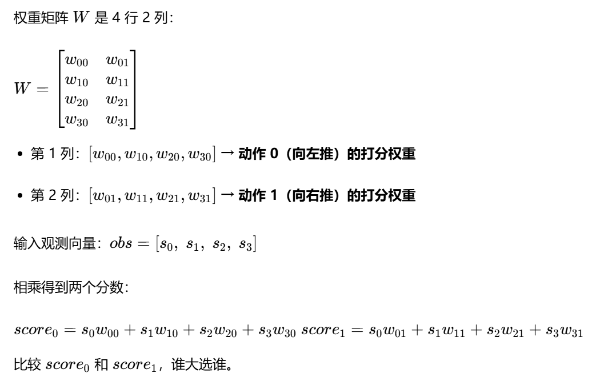

# 强化学习入门

## 随机搜索策略（random search policy）算法

使用的仍旧是CartPole游戏，游戏目的是为了获取更高的回报（reward），最高为500

先把 CartPole 四个状态再明确一遍（gym 原版）：

- \(s_0\)：小车位置（cart position）
- \(s_1\)：小车速度（cart velocity）
- \(s_2\)：杆角度（pole angle）
- \(s_3\)：杆角速度（pole angular velocity）

终止判断规则：

1. \(|s_0|>2.4\)：小车跑出左右边界 → 结束
2. \(|s_2|>12°)（弧度大约 0.209 rad）：杆子歪过头 → 结束

👉 **\(s_1\)（小车速度）、\(s_3\)（杆角速度）不会直接触发游戏结束。** 但！**不触发终止 ≠ 对控制没用，反而是非常关键的信息。**

**\(s_3\)：杆子角速度（杆子正在往哪边倒、倒得多快）**

只看杆子角度 \(s_2\) 是不够的。 举两个场景： 场景 A：杆子现在偏了 3 度（\(s_2\)= 小正数），但是**角速度是负的**，它正在自己往回摆，马上就要扶正。 场景 B：杆子同样偏了 3 度（\(s_2\)= 同样小正数），但是**角速度是很大正数**，它正在加速往右倒，下一瞬间就会超标翻车。

> 这两种情况，\(s_2\) 一样！但是我们要做的动作完全不一样。
>
> - A：不用猛推，甚至可以缓一缓
> - B：必须立刻大力往反方向推

如果策略看不到 \(s_3\)，它就分不清这两种情况，很容易反应慢一拍，杆子直接倒。 一句话：**\(s_2\) 是 “现在歪了多少”；\(s_3\) 是 “歪的趋势有多猛”**。 这就是微分信息，和 PID 里的 D 项（微分项）是一个道理。

**\(s_1\)：小车自身的水平速度**

同样举例子： 小车现在位置 \(s_0=0.5\)（在中心点右边一点） 情况 1：小车速度 \(s_1\) 是负数，正在往左跑，马上回到中间 情况 2：小车速度 \(s_1\) 是正数，还在继续往右冲，很快就要冲出 2.4 边界

\(s_0\) 相同，但趋势完全不同。

- 情况 1：不用往右推
- 情况 2：必须赶紧往左刹车、拉回来

小车位置只是快照；小车速度告诉你：**它接下来会往哪里跑**。



### 为什么有时候同样的矩阵，偶尔跑不到 500？

**CartPole 每一局的初始状态是随机的！** 每一个 episode 开局的时候，环境会给一组随机的初始 obs（小车位置、速度、杆角度、角速度，在很小的区间内随机采样）。

- 有的开局很好：杆子基本竖直，小车在中间，这套权重轻松稳住，跑到 500；
- 有的开局比较极限：开局杆子就歪一点、还有往一边倒的初速度。 这套权重**是在某次开局下拿到了 500 分**，不代表它能应对所有开局。

### 4x2的矩阵是怎么想出来的

**核心一句话**

**4×2不是“猜出来”的，是先定好【输入是什么、输出是什么】，线性映射自然而然推出来的矩阵形状。** 它不是灵光一闪想到要用4×2，而是先回答两个问题：

1. 我的输入，有几个数？（输入维度）
2. 我想要输出几个数？（输出维度）

#### 第1步：先看任务，确定输入

CartPole 给你的观测 obs：`[小车位置，小车速度，杆角度，杆角速度]` 一共 4 个数字 → **输入向量长度 = 4**

> 我们现在打算做【线性策略】，不用隐藏层、不用激活函数，就单纯：输入向量乘一个权重矩阵，得到输出。

#### 第2步：确定我们想要什么输出

我们有2个动作：动作0（左）、动作1（右）。 我们的方案是：输出两个分数，每个动作对应一个分数，**哪个分数大就选哪个动作**。 所以我们希望输出是2个数字 → **输出向量长度 = 2**

#### 第3步：线性变换的规则（大白话矩阵乘法）

线性映射就是： `y = x * W`

- `x`：形状是 `(1, 4)`，一行4个数
- `y`：形状是 `(1, 2)`，一行2个数

矩阵乘法有硬性规则：

> `(1,4) × (4,2) = (1,2)` 左边矩阵的**列数** = 右边矩阵的**行数**，才能相乘。 结果矩阵的行数=左边行数，列数=右边列数。

👉 所以中间这个权重矩阵 `W`，必须是 **4行，2列 → 4×2**。

> 这里很容易搞混另一种写法：有的人写成 `y = W * x`，W是2×4，只是向量写成列向量的习惯，本质完全一样，只是排版习惯，论文里两种写法都能见到。 咱们原文用的是行向量版本，所以是4×2。

#### 梳理思考顺序（以后遇到别的环境，也能自己推）

以后碰到新环境，想做这种简单线性策略，固定思考顺序：

1. 看环境obs：数一下观测有多少个值 → 输入维度 `D_in`
2. 看动作空间：有多少个离散动作 → 输出维度 `D_out`
3. 如果是行向量写法：权重矩阵形状 = `D_in × D_out`
4. 如果是列向量写法：权重矩阵形状 = `D_out × D_in`

举例子巩固：

- 假设一个新环境，观测是5维，3个动作，行向量版本线性策略：权重矩阵就是 5×3

#### 重点区分：这一步只是【选择模型结构】，不是算法本身

随机搜索是**优化/找权重的方法**； 4×2矩阵是**我们选的策略模型结构**。 两件事分开：

1. 我先决定：我就用最简单的线性模型（没有隐藏层），输入直接映射动作分数；
2. 根据输入输出的数量，算出矩阵必须是4×2；
3. 再用随机搜索这个办法，不停随机生成这个4×2矩阵，挑最好的。

> 不是随机搜索要求必须4×2； 是：CartPole输入4、输出2 + 选用单层线性映射 → 自然得到4×2。

#### 对比一下，如果我们不选线性，会怎么样？

如果你不想直接4→2，想加一层隐藏层，比如隐藏层有8个神经元：

- 第一层权重：4×8（4输入映射到8个隐藏值）
- 第二层权重：8×2（8个隐藏值映射到2个动作分数） 这就是一个2层小神经网络了，也就是之前说的MLP。 原文那个版本是**没有隐藏层，单层线性**，所以就只有一个4×2矩阵。

#### 一个容易踩坑的疑问

问：我能不能强行用别的形状？比如 4×3？ 答：不行。 因为矩阵乘法算不通：`(1,4) @ (4,3)` 得到的是3个输出，但是我们只需要2个动作分数，多出来一个数没用。 形状是被输入输出的数量+线性变换的数学规则锁死的，不是随便挑的。

#### 极简复盘思考链

CartPole

- ✅ obs：4个数字 → 输入维度=4
- ✅ 动作：2个，输出2个分数 → 输出维度=2
- ✅ 策略形式：单层线性 `y = x * W`，行向量
- ✅ W形状：输入维度 × 输出维度 = 4 × 2

------

## 带自适应噪声的爬山搜索（hill-climbing algorithm）

**算法思路**

这是 **噪声搜索（Noise Search）**，比纯随机搜索多了一步"在最优权重附近扰动"：

1. 从一个随机权重出发。
2. 每次在当前最优权重上加一个小噪声，生成新权重。
3. 如果新权重表现更好（或持平），就接受它。
4. **自适应噪声**：表现好就缩小噪声（精细搜索），表现差就放大噪声（扩大探索）。

这比第一份代码的纯随机搜索效率高不少，但依然**没有梯度**，属于黑盒优化。真正的策略梯度（REINFORCE）会利用奖励信号计算梯度，有方向地更新权重。

这四段其实是在做同一件事：**用“在最优权重上加噪声”的方式搜索好策略**，只是搜索方式越来越聪明。

### 为什么要写 `noise_scale * rand + 权重`

它的意思是：

```python
weight = best_weight + noise_scale * torch.rand(n_state, n_action)
```

- `best_weight`：目前找到的**最好策略**。
- `torch.rand(...)`：生成一个随机扰动。
- `noise_scale`：控制扰动有多大。
- 加起来后得到：**在最优策略附近稍微变一点的新策略**。

这就像你站在一个觉得还不错的位置，然后往四周小步试探：
如果新位置更好，就搬过去；如果更差，就退回原来的位置。

它不是纯随机搜索，而是**局部搜索 / 参数空间噪声搜索**。

### 第一部分：基础噪声搜索

```python
weight = best_weight + noise_scale * torch.rand(...)
```

逻辑很简单：

1. 从当前最优权重出发。
2. 加一点随机噪声，得到新权重。
3. 如果新权重得分更高，就替换掉旧权重。
4. `noise_scale` 固定不变。

缺点：噪声大小不会自动调整。可能探索不够，也可能跳得太远。

### 第二部分：自适应噪声搜索

这里多了噪声缩放：

```python
if total_reward >= best_total_reward:
    best_weight = weight
    noise_scale = max(noise_scale / 2, 1e-4)
else:
    noise_scale = min(noise_scale * 2, 2)
```

意思是：

- **找到更好权重**：说明方向对了，就缩小噪声，做精细搜索。
- **没找到更好权重**：说明当前附近可能没有更好的，就放大噪声，扩大搜索范围。

这比第一部分更聪明，因为它会自动在“精细搜索”和“扩大探索”之间切换。

### 第三部分：评估最优权重

这一部分不再搜索，只是把第二部分找到的 `best_weight` 拿来跑 100 次：

```python
total_reward = run_episode(env, best_weight)
```

目的是看它是不是真的稳定，而不是某一次运气好。

### 第四部分：自适应噪声 + 早停

这部分和第二部分一样，但加了早停条件：

```python
if episode >= 99 and sum(total_rewards[-100:]) >= 49500:
    break
```

因为 CartPole-v1 满分是 500，所以：

```text
49500 / 100 = 495
```

表示最近 100 轮平均奖励达到 495 分，已经非常接近满分，就可以提前结束训练。

### 和纯随机搜索的区别

纯随机搜索是每次从零生成新权重：

```python
weight = torch.rand(n_state, n_action)
```

而这里是：

```python
weight = best_weight + noise_scale * torch.rand(...)
```

差别在于：
**纯随机搜索是到处乱蒙；噪声搜索是围绕当前最优解不断微调。**

所以噪声搜索通常比纯随机搜索更容易找到好权重，但它仍然不是策略梯度。策略梯度会利用奖励信号计算梯度，有方向地更新权重；这里只是靠“试 + 比较”来改进。

------

## 蒙特卡洛（Monte Carlo Policy Gradient）

蒙特卡洛策略梯度，是**策略梯度（Policy Gradient）里最简单的版本**。它直接用一整条回合（episode）结束之后得到的**真实总回报**来更新策略网络，不需要时序差分、不需要价值网络，依赖完整轨迹。

1. **随机实验**：满足 3 个条件
   - 可以重复做；
   - 实验之前不知道结果；
   - 所有可能结果是明确的。 例子：扔硬币、掷骰子。
2. **伯努利试验，是只有两种结果的随机实验** 结果只能分成两类，一般叫：

- 成功（事件 A 发生）
- 失败（事件 A 不发生）

随机搜索 / 爬山： 策略是**确定性策略**：输入状态，直接算两个分数，永远选分数更大的动作。

蒙特卡洛策略梯度这里： 策略是**随机策略**：网络输出的不是 “哪个动作更好”，而是**选动作 0 的概率、选动作 1 的概率**。

==其实可以使用神经网路的先行层去写，因为输入的是4，输出的是2==

```python
class PolicyNet(nn.Module):
    def __init__(self, in_dim, out_dim):
        # 固定写法，继承pytorch网络基类
        super().__init__()
        # 线性层：输入4，输出2
        # 计算公式： z = x @ W + b
        # W就是4行2列权重矩阵，b是偏置
        self.linear = nn.Linear(in_dim, out_dim)

    def forward(self, x):
        """
        前向传播函数
        x：输入，4维状态张量 [s0,s1,s2,s3]
        return：两个动作的概率，总和=1
        """
        # 线性变换，得到两个logit（还不是概率，只是原始打分）
        z = self.linear(x)
        # softmax：把两个打分转换成0~1之间的概率，两个概率相加等于1
        prob = torch.softmax(z, dim=0)
        return prob

def run_episode(env, policy):
    """
    【蒙特卡洛核心函数：只收集一整条轨迹，不更新网络！】
    跑一局游戏，和环境交互，记录这条轨迹上所有：状态、动作、奖励
    参数：
        env：游戏环境
        policy：当前的策略网络
    返回：
        states：列表，存这一局每一步的状态
        actions：列表，存这一局每一步选的动作
        rewards：列表，存这一局每一步拿到的奖励
    """
    # 重置环境，开局，拿到初始状态
    state, info = env.reset()
    # 三个空列表，用来保存整条轨迹信息
    states = []
    actions = []
    rewards = []
    # terminated=True：杆子倒了 / 小车跑出边界，游戏自然结束
    terminated = False
    # truncated=True：步数跑到500，达到上限强制结束
    truncated = False

    # 循环：一步一步和环境交互，直到本局结束
    while not (terminated or truncated):
        # 把numpy格式的状态，转成pytorch浮点张量，才能送入网络
        state_tensor = torch.from_numpy(state).float()

        # ========== 前向传播 ==========
        # 把状态喂给策略网络，自动调用forward，算出两个动作的概率
        # probs[0] = 选动作0（左）的概率
        # probs[1] = 选动作1（右）的概率
        probs = policy(state_tensor)

        # 随机采样动作（随机策略！不是直接选概率最大的）
        # 伯努利分布：以probs[1]概率选1，剩下概率选0，用来探索
        action = int(torch.bernoulli(probs[1]).item())

        # ✅ 保存当前这一步的信息到轨迹列表（收集轨迹，蒙特卡洛重点！）
        states.append(state)
        actions.append(action)

        # 把动作传给环境，环境往前走一步，返回新状态、奖励、结束标记
        state, reward, terminated, truncated, info = env.step(action)
        # 把这一步拿到的奖励存起来
        rewards.append(reward)

    # while循环退出 = 本局游戏结束，整条轨迹收集完毕，返回轨迹数据
    return states, actions, rewards
```

其实蒙特卡洛保留的是轨迹，但是本书中保留的是梯度。

W = W + α・∇J (W) 拆开，对每一步单独更新，就是书上这个核心式子： W = W + α・∇logπ(aₜ|sₜ)・Gₜ

对应代码： weight += learning_rate * gradient * (total_reward - i)

**新权重 = 旧权重 + 学习率 × 【增加这个动作概率的方向】 × 【这个动作后续能拿到的分数】**